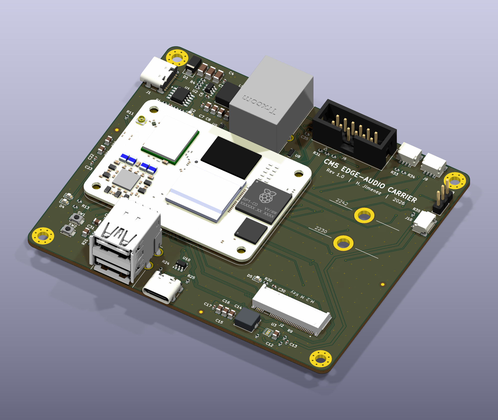
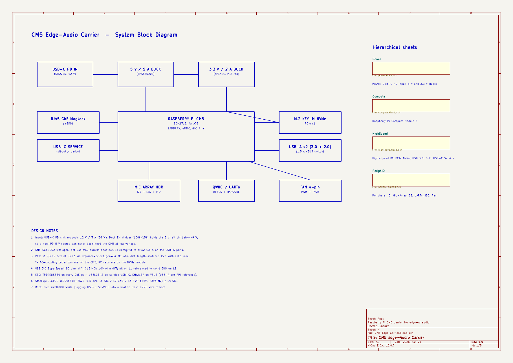
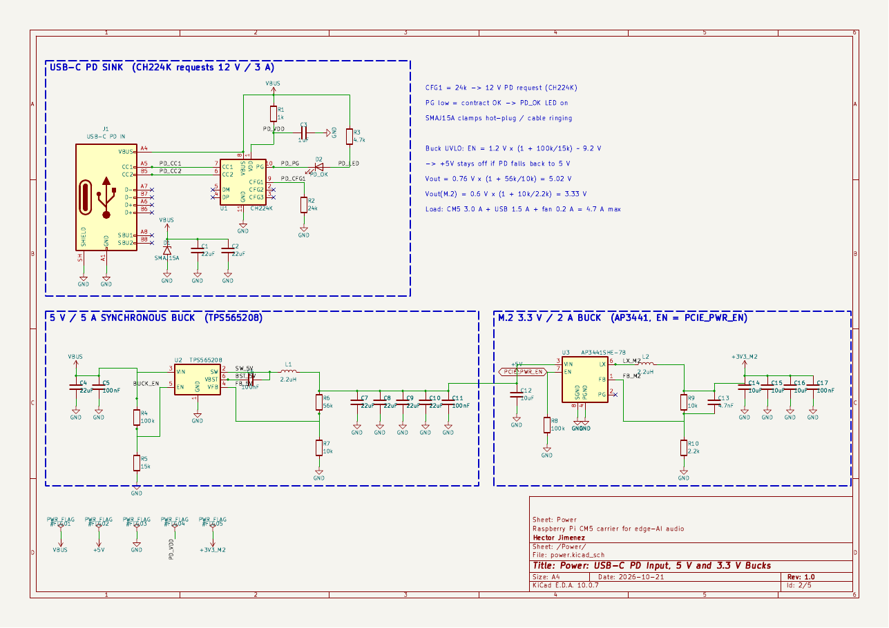
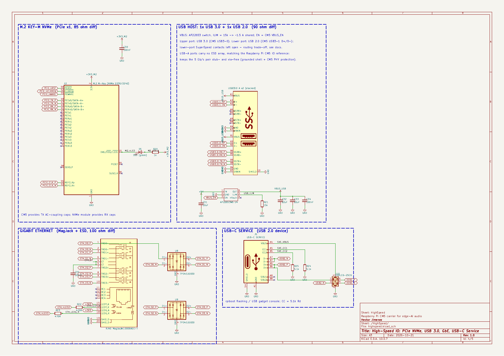
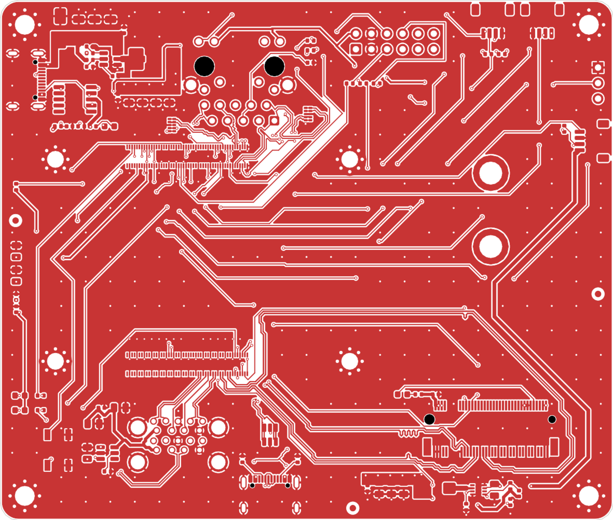
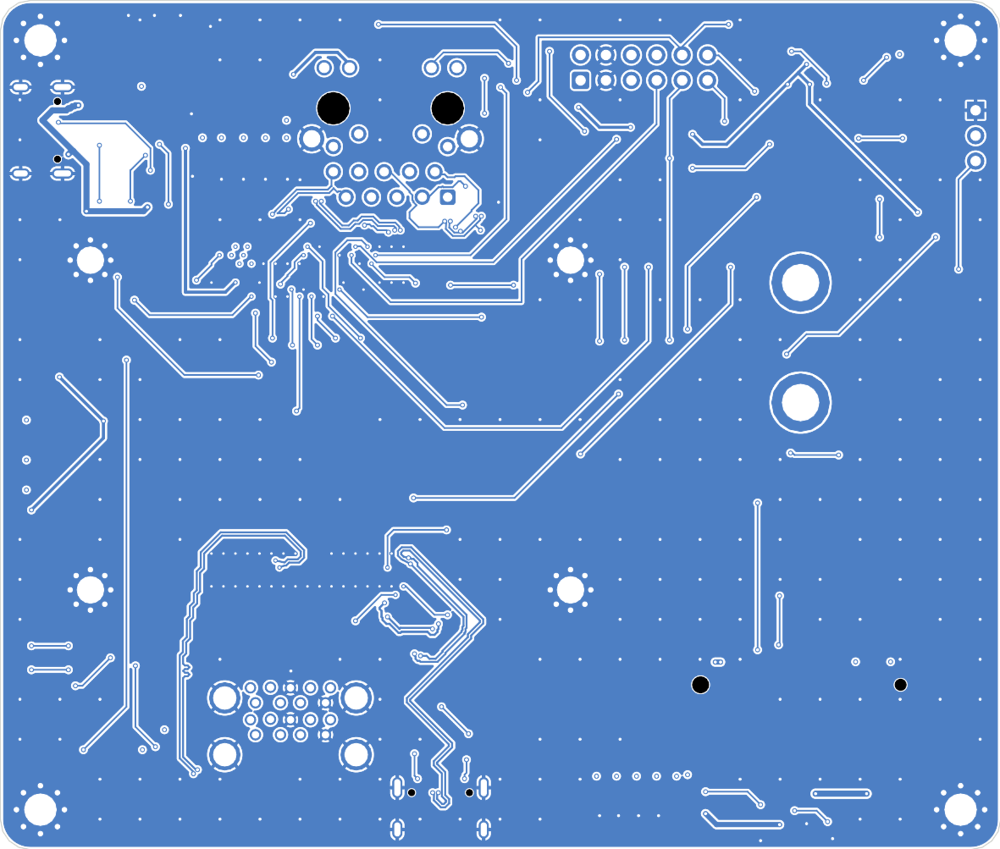
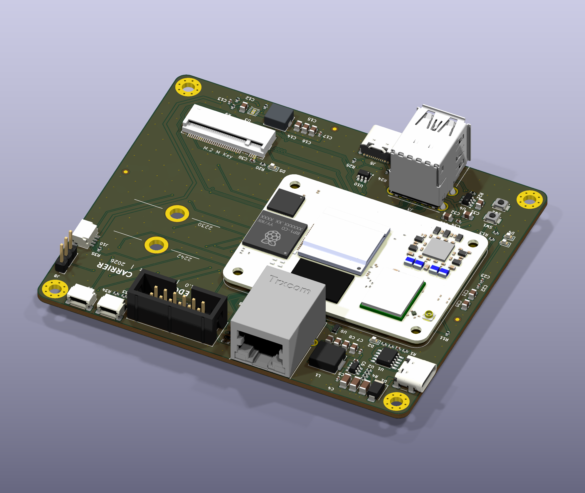
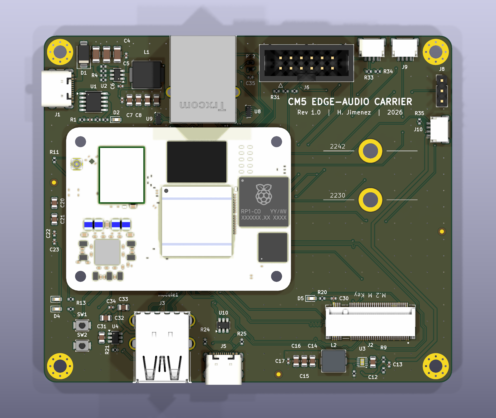

# CM5 Edge-Audio Carrier

A compact **Raspberry Pi Compute Module 5 carrier board** for an always-on edge-AI audio
appliance. It is designed in **KiCad 10**, impedance-controlled on a **4-layer JLCPCB stack**,
and fully routed with **0 DRC errors, 0 unconnected items and 0 schematic-parity issues**.



| | |
|---|---|
| **Compute** | Raspberry Pi CM5 (BCM2712, 4x Cortex-A76) on 2x Hirose DF40 100-pin receptacles |
| **Board** | 100 x 85 mm, 4 layers, 1.6 mm, JLC04161H-3313 stackup, ENIG |
| **Power in** | USB-C PD sink (CH224K) negotiates **12 V / 3 A**, with a TVS-clamped input |
| **Rails** | 5 V / 5 A synchronous buck (TPS565208); 3.3 V / 2 A buck for NVMe (AP3441), gated by the CM5 |
| **Storage** | M.2 Key-M socket, NVMe 2230/2242, PCIe x1 (Gen2, Gen3 capable) |
| **USB** | 1x USB 3.0 (5 Gb/s) + 1x USB 2.0 in a stacked Type-A with a 1.5 A current-limited VBUS |
| **Network** | Gigabit Ethernet RJ45 MagJack with an ESD array on every MDI pair |
| **Audio link** | 2x6 header to a 6-mic XVF3800 array: I2S + I2C control + reset/IRQ |
| **Other I/O** | USB-C service port (rpiboot / gadget), debug UART, barcode-scanner UART, Qwiic I2C, PWM fan, status LEDs, power and boot buttons |
| **Parts** | 90 footprints, 231 nets, 474 vias, 3.4 m of copper |

---

## 1. System architecture



The board started from the requirements of a Jetson Orin NX carrier for emergency-vehicle
audio. It keeps the same functional set (PD power path, NVMe, high-speed USB, GbE, I2S
mic-array link, UART/I2C management, ESD on external ports), but runs on a Raspberry Pi
CM5. Every peripheral maps to a native CM5 interface, so the carrier needs **no bridge ICs**:

| Function | CM5 interface | Carrier hardware |
|---|---|---|
| NVMe SSD | PCIe x1 (+REFCLK, PERST#, CLKREQ#, WAKE#) | M.2 Key-M socket + switched 3.3 V rail (`PCIE_PWR_EN`) |
| USB 3.0 port | USB3-0 SuperSpeed + D+/D- | Stacked Type-A (upper port), AP22653 VBUS switch |
| USB 2.0 port | USB3-1 D+/D- | Stacked Type-A (lower port) |
| Flashing / gadget | USB2 OTG | USB-C service port, USBLC6-2 ESD, 5.1k Rd |
| Ethernet | On-module BCM54210 PHY, MDI x4 | TRJG0926HENL MagJack + 2x TPD4EUSB30 |
| Mic array | PCM/I2S on GPIO18-21, I2C1, GPIO26/27 | 2x6 shrouded header, 33 ohm source termination |
| Scanner / console | UART2 / UART0 | JST-SH 4-pin / 1x3 header |

## 2. Schematic

Five hierarchical sheets ([PDF](docs/CM5_Edge_Carrier_schematic.pdf)): Root (block diagram and
notes), Power, Compute Module, High-Speed IO, and Peripheral IO.

| Power | High-speed IO |
|---|---|
|  |  |

Key circuit decisions:

* **PD with UVLO interlock.** The CH224K requests 12 V (`CFG1` = 24k). The buck's EN divider
  (100k/15k) sets the turn-on point near 9 V. If a charger can only give 5 V, the 5 V rail stays
  off instead of browning out the CM5.
* **Buck sizing.** V<sub>out</sub> = 0.76 V x (1 + 56k/10k) = 5.02 V. The worst-case load is
  CM5 3 A + USB 1.5 A + fan 0.2 A = 4.7 A, under the TPS565208's 5 A rating.
  The NVMe rail uses V<sub>out</sub> = 0.6 V x (1 + 10k/2.2k) = 3.33 V and has a 4.7 nF feed-forward cap.
* **The NVMe rail is gated by the SoC** (`PCIE_PWR_EN` with a 100k pull-down). The SSD stays
  unpowered until the bootloader wants it, as on the Raspberry Pi reference design.
* **The ESD strategy follows the threat.** SMAJ15A on the PD input, TPD4EUSB30 on all four GbE
  pairs, and USBLC6-2 on the service port. The USB-A ports follow the Raspberry Pi CM5 IO
  reference, which has no array on the 5 Gb/s pair, so that pair stays stub- and via-free.

## 3. PCB layout

| Top copper | Bottom copper |
|---|---|
|  |  |

**Floorplan.** The CM5 is rotated so its high-speed connector (PCIe/USB) faces the front edge.
The USB 3.0 jack, the service USB-C and the M.2 socket sit directly at those pins. The Ethernet
pins face the rear edge, where the MagJack is. Power enters at the top-left and the M.2 buck
sits next to the socket. Nothing is placed under the module.

**Stackup and impedance.** JLC04161H-3313: L1 signal / **L2 solid GND** / L3 power (+5 V plane
with a +3V3_M2 island) / L4 signal. The widths below were solved with the
[KiCadRoutingTools](https://github.com/drandyhaas/KiCadRoutingTools) microstrip models for L1
over 0.0994 mm 3313 prepreg (εr 4.1):

| Class | Target | Width / gap | Calculated |
|---|---|---|---|
| PCIe TX/RX/REFCLK | 85 ohm diff | 0.20 / 0.15 mm | 85.6 ohm |
| USB 3.0 SS, USB 2.0 | 90 ohm diff | 0.18 / 0.15 mm | 90.8 ohm |
| 1000BASE-T MDI | 100 ohm diff | 0.16 / 0.18 mm | 100.0 ohm |

**High-speed results**, measured from the routed copper by `scripts/si_report.py`:

| Pair | Length P / N (mm) | Intra-pair skew | Vias | Layer |
|---|---|---|---|---|
| PCIe TX | 52.33 / 52.33 | 0.01 mm | 0 | L1 only |
| PCIe RX | 99.69 / 99.69 | 0.00 mm | 0 | L1 only |
| PCIe REFCLK | 50.02 / 49.76 | 0.26 mm | 4 | L1/L4 (must cross TX/RX) |
| USB 3.0 SSTX | 11.37 / 11.33 | 0.04 mm | 0 | L1 only |
| USB 3.0 SSRX | 9.20 / 9.20 | 0.00 mm | 0 | L1 only |
| USB-A1 D+/D- | 10.66 / 11.24 | 0.58 mm | 0 | L1 only |
| USB-A2 D+/D- | 55.01 / 55.07 | 0.06 mm | 4 | L1/L4 |

The 5 Gb/s and PCIe data pairs stay on L1, over an unbroken L2 ground, with no layer changes,
and their P/N lengths are matched with meanders. The Ethernet pairs carry short T-stubs to their
ESD clamps. At 125 MBd those stubs are electrically negligible.

**Power stage.** Both bucks are laid out by hand on top-layer copper pours: input cap, then IC,
then inductor, then output caps, in a tight loop with stitched returns. The CM5's 0.4 mm-pitch
DF40 pads use a custom staggered escape fanout (0.4/0.2 mm vias, 3 levels) that keeps the
design on JLC's standard process. Outer GND pours are stitched to L2 on a 4 mm grid
(about 210 vias).

| Rear (RJ45, mic header) | Top |
|---|---|
|  |  |

## 4. Engineering trade-offs (documented, deliberate)

1. **CM5 instead of Jetson Orin NX.** The same functions at a fraction of the power and cost. NVMe
   runs at PCIe Gen2/3 x1 instead of Gen3 x4.
2. **Lower USB-A port is USB 2.0.** The far contact row of a stacked USB3 jack is only reachable
   by threading pairs between the near-row pins. One clean 5 Gb/s port covers the 5G-modem use
   case, so the CM5's second SuperSpeed lane is left unconnected.
3. **No battery charger.** The input path is PD to buck. A UPS or battery stage would be a
   daughterboard.
4. **The CM5 CC1/CC2 pins are left open.** PD is negotiated by the CH224K, so set
   `usb_max_current_enable=1` in `config.txt` to get full USB current.
5. **LCSC codes** are filled in where verified against the LCSC catalogue (October 2026). The
   remaining lines are ordered by manufacturer part number.

## 5. Fabrication package (`fab/`)

* `CM5_Edge_Carrier_gerbers.zip`: Gerber X2 for 4 copper layers, mask, paste, silk, outline, and Excellon drills
* `CM5_Edge_Carrier_BOM_JLC.csv` / `CM5_Edge_Carrier_CPL_JLC.csv`: JLCPCB SMT assembly format
* `CM5_Edge_Carrier.step`: full 3D assembly, including the CM5 module
* `CM5_Edge_Carrier_schematic.pdf`, `CM5_Edge_Carrier_top_assembly.pdf`

Order notes: JLC04161H-3313 impedance control, 1.6 mm, ENIG, minimum via 0.4/0.2 mm, and
minimum track/space 0.1/0.1 mm. Everything is on JLC's standard multilayer tier.

## 6. Reproducible design flow (`scripts/`)

The schematic, board, routing and fab outputs are generated from one design database, so
they cannot drift apart:

```
design.py          parts, values, nets, schematic placement     (single source of truth)
gen_sch.py         -> hierarchical KiCad schematic with wires, labels and frames
check_netlist.py   KiCad-exported netlist == design.py           (catches any wiring error)
gen_pcb.py         -> board: floorplan, stackup, netclasses, power-stage pours
fanout_cm5.py      staggered DF40 escape vias
route_chain.sh     KiCadRoutingTools: diff pairs (85/90/100 ohm, length-matched) -> general routing
finish_pcb.py / stitch_gnd.py / silk_cleanup.py   zone fill, GND stitching, silkscreen placement
si_report.py       length / skew / via report
make_outputs.sh    Gerbers, drills, JLC BOM/CPL, STEP, PDFs, renders
```

`scripts/build_all.sh` runs the whole flow, from schematic to a DRC-clean routed board, in
about 4 minutes. Requirements: KiCad 10 (its bundled Python runs the `pcbnew` scripts; the
paths are set at the top of each shell script), plus
`git clone https://github.com/drandyhaas/KiCadRoutingTools ref/KiCadRoutingTools` followed by
`python3 ref/KiCadRoutingTools/build_router.py`.

## 7. Repository layout

```
hardware/   KiCad 10 project (schematic, PCB, project rules, project symbol/footprint/3D library)
fab/        manufacturing outputs
docs/       renders, layer plots, schematic PDF
scripts/    generators and build flow
```

## Credits and licenses

* The CM5 symbol, DF40 footprint, magjack, stacked USB3 and M.2 footprints and their 3D models
  are adapted from the **Raspberry Pi CM5 IO Board** KiCad design files (Raspberry Pi Ltd,
  [design-files licence](https://pip.raspberrypi.com)). The CM5 STEP model is © Raspberry Pi Ltd.
* Approach inspired by Shawn Hymel's
  [CM4 carrier template](https://github.com/ShawnHymel/rpi-cm4-carrier-template) and the
  [MakerForge CM5 carrier basics](https://www.makerforge.tech/posts/cm5-carrier-basics/).
* Routing by [KiCadRoutingTools](https://github.com/drandyhaas/KiCadRoutingTools) (MIT).
  Design review by [kicad-happy](https://github.com/aklofas/kicad-happy).
* This design: hardware files are CC BY 4.0, scripts are MIT. Hector Jimenez, 2026.
